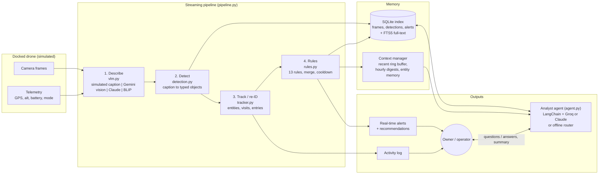
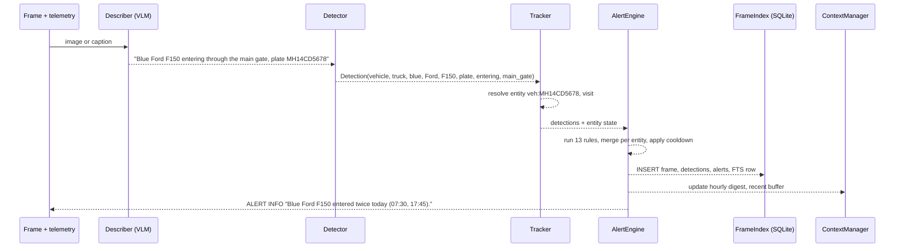
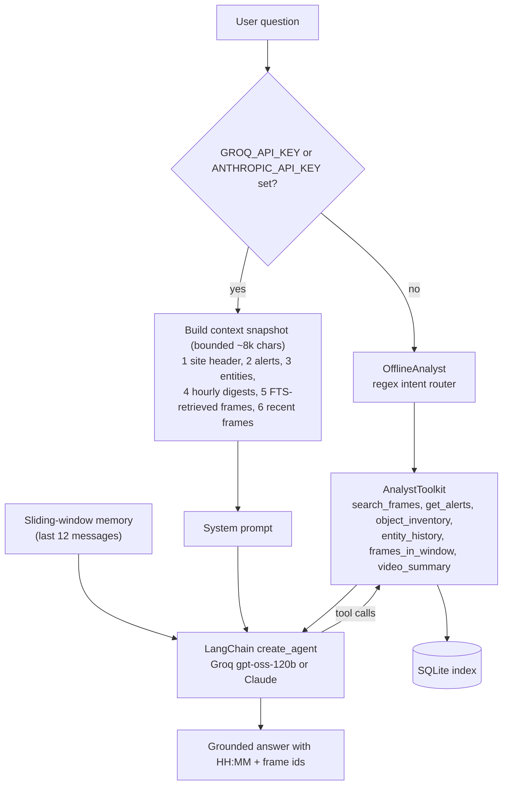
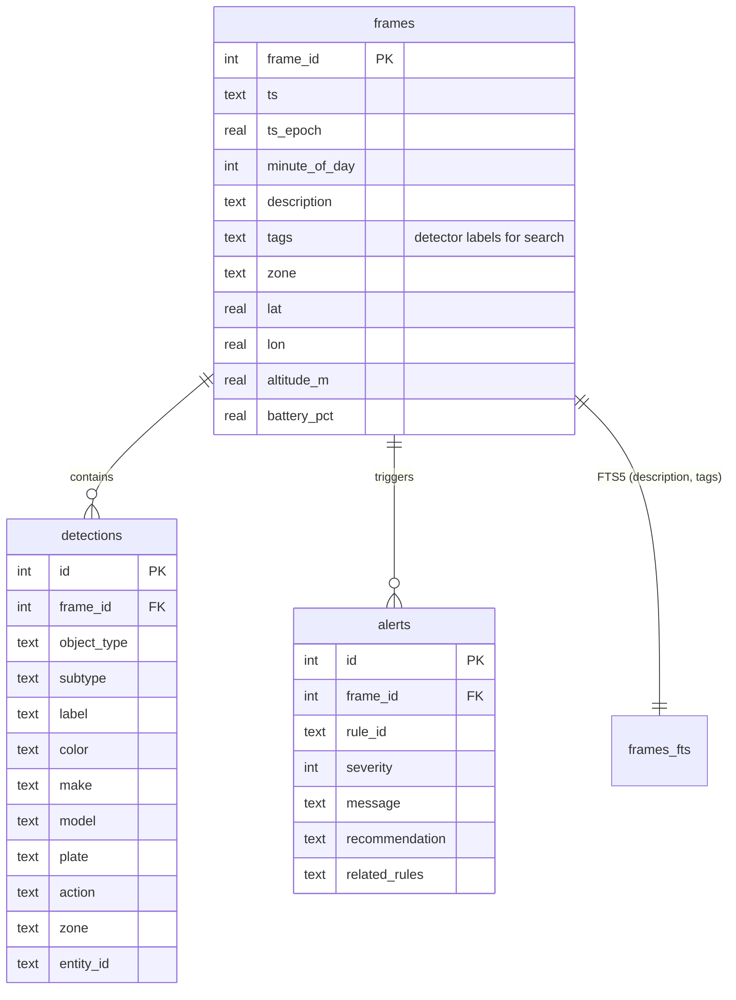

# Architecture

## 1. System overview

## 2. Per-frame sequence

## 3. Agent question flow (context management)

## 4. Data model (SQLite)

## 5. Design decisions

| Decision | Why | Trade-off |
|---|---|---|
| **One function per stage, in-process** | Simple to test and debug; every stage boundary is where a queue would go in production | Single process; no horizontal scaling yet |
| **Caption first, then parse** (VLM → text → structured) | A caption works for indexing, search, the LLM and humans at once. The same parser serves simulated and real frames | Parsing depends on caption quality; mitigated by a security-specific VLM prompt |
| **Deterministic detector and rules** (lexicon + regex, pure functions) | About 1 ms/frame, explainable, unit-testable, zero cost. An LLM is used where it adds value: captioning and Q&A | Lower recall on unusual phrasing; the LLM agent can still use free-text search |
| **SQLite + FTS5** for the index | Zero-ops, ships with Python, B-tree and BM25 search in one file, handles millions of rows | Single writer; Postgres/pgvector or OpenSearch at fleet scale |
| **`tags` column in FTS** | "show all truck events" finds "Blue Ford F150 parked at the garage", even though the caption never says "truck" | Small storage overhead |
| **Entity re-ID** by plate, then visual signature, with plate-to-signature linking | Enables "entered twice today" and dwell-time loitering | Naive for people; production would use appearance embeddings |
| **Alert merge + cooldown** | One actionable alert per subject per frame, with no alert storms | Related rules are listed rather than raised separately |
| **Rules as data** (`config/default.yaml`) | Owners can tune hours, thresholds and whitelists without code | Complex rules still need Python |
| **Tiered context manager** | Prompt cost stays roughly constant (~8k chars) whether the video has 90 or 50,000 frames | Summaries lose detail, which the tools recover on demand |
| **Two agent brains, one toolkit** | Works offline for demos and CI; Claude adds reasoning, phrasing and multi-step tool use | Offline answers are templated |

## 6. Production path
1. Ingest RTSP or a drone SDK stream through a message queue (Kafka/NATS), with one topic per stage.
2. Add a real detector (YOLOv8/RT-DETR) for boxes and tracking (ByteTrack), plus a VLM for captions of keyframes only.
3. Add CLIP/SigLIP image embeddings in a vector store for "find frames that look like this".
4. Deliver alerts through webhooks, push notifications or a VMS integration, with guard acknowledgement and an escalation timer.
5. Move the index to Postgres (Timescale + pgvector) with per-site partitioning and a retention policy.
